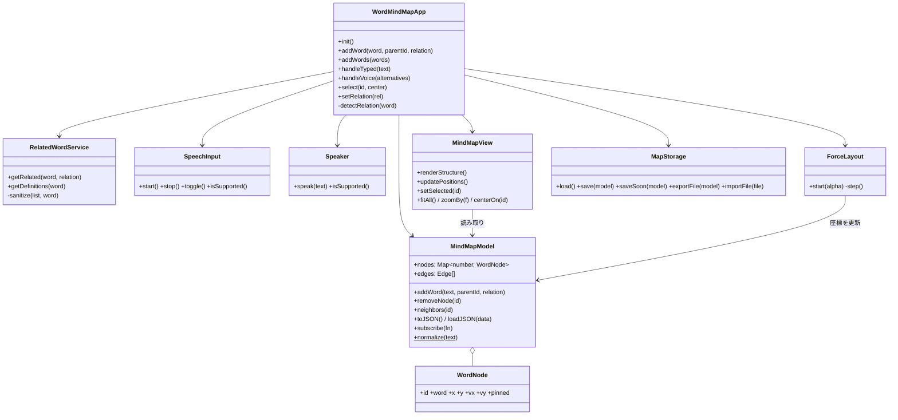
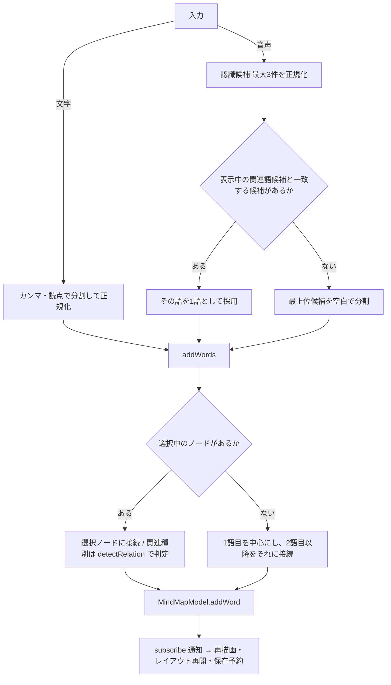

# Word Mind Map システム概要

英単語を中心に、関連語（連想・類義語・対義語・意味が近い語）をつないでマインドマップを作る Web アプリです。
音声入力（Web Speech API）で単語を追加できます。ビルド不要の静的ファイル（HTML / CSS / JavaScript）だけで動きます。

## 1. システム構造

```
mindmap/
├── index.html            画面の骨組み。スクリプトは依存順に読み込みます
├── css/style.css         スタイル（ライト／ダーク、スマートフォン幅に対応）
├── js/
│   ├── model.js          RELATIONS 定数, WordNode, MindMapModel（データ層）
│   ├── related-words.js  OFFLINE_DICTIONARY, RelatedWordService（関連語・定義の取得）
│   ├── speech.js         SpeechInput（音声認識）, Speaker（読み上げ）
│   ├── layout.js         ForceLayout（力学モデルによる自動配置）
│   ├── view.js           MindMapView（SVG 描画・ドラッグ・パン・ズーム）
│   ├── storage.js        MapStorage（localStorage 保存、JSON の書き出し・読み込み）
│   └── app.js            WordMindMapApp（各クラスをつなぐコントローラ、起動処理）
└── docs/SYSTEM_OVERVIEW.md  本書
```

ES Modules ではなく通常の `<script>` で読み込んでいます。`file://` で直接開いた場合でも、モジュールの CORS 制限を受けずに動かすためです。

### 外部依存

| 依存先 | 用途 | 失敗したときの動作 |
|---|---|---|
| Datamuse API `https://api.datamuse.com/words` | 関連語（`rel_trg`, `rel_syn`, `rel_ant`, `ml`）と英英定義（`md=d`） | 内蔵の小さな辞書（約25語）に切り替え、その旨を画面に表示します |
| Web Speech API `SpeechRecognition` / `webkitSpeechRecognition` | 音声入力 | マイクボタンを無効化し、ツールチップで案内します |
| Web Speech API `speechSynthesis` | 発音の読み上げ | 発音ボタンを無効化します |

## 2. クラス設計



### 責務の分担

- **MindMapModel**：単語の正規化（小文字化・記号除去）、重複防止、エッジの重複防止、JSON の入出力を担当します。DOM には触れません。変更は `subscribe` で通知します。
- **RelatedWordService**：通信と結果のキャッシュを担当します。同じ単語・関連種別の問い合わせは Promise ごとキャッシュし、失敗時はキャッシュを消して再取得できるようにしています。候補は「英字・ハイフン・アポストロフィからなる2語以内」に絞ります。
- **SpeechInput**：1回の発話ごとに確定する設定（`continuous = false`）で、途中経過（`interimResults = true`）と候補3件（`maxAlternatives = 3`）を受け取ります。エラーコードは日本語メッセージに変換します。
- **MindMapView**：ノード要素は ID ごとに再利用し、毎フレームは位置（`transform` 属性）だけを更新します。同じ ID で単語が変わった場合（JSON 読み込み時）は要素を作り直します。
- **ForceLayout**：反発力（O(n²)）、ばね力、原点への引力、減衰の4要素による簡易シミュレーションです。`alpha` が 0.01 を下回ると停止します。
- **WordMindMapApp**：画面イベントの処理、パネル描画、音声と候補の照合を担当します。

## 3. 処理フロー

### 3.1 単語の追加（文字入力・音声入力共通）



`detectRelation` は、読み込み済みの候補一覧に単語があればその関連種別（例：連想）を、無ければ「手動」を返します。これにより、候補を声に出すだけで正しい色の線でつながります。

### 3.2 単語の選択

1. ノードをクリック → `MindMapView` が `onSelect` を呼びます（4px 以上動いた場合はドラッグ扱い）。
2. `WordMindMapApp.select` がパネルを描画し、英英定義と、選択中の関連種別の候補を非同期に取得します。
3. 通信中に選択が変わった場合は、古い結果を描画しません（定義は連番、候補はノード ID と関連種別で判定）。

### 3.3 保存

- 構造の変更・ドラッグのたびに 600ms 後に localStorage へ保存します（連続した変更は1回にまとめます）。
- `pagehide` と `visibilitychange`（hidden）で即時保存します。
- 「書き出し」で JSON をダウンロード、「読み込み」で JSON を復元します。不正なノード・エッジは読み込み時に除外します。

## 4. 制約と既知の注意点

- **音声入力の対応ブラウザ**：Chrome / Edge / Safari を想定しています。Firefox は既定では非対応の可能性が高いです（開発時に公式ドキュメントへ到達できず、最新の対応状況は未確認です）。
- **音声入力の実行環境**：マイクはセキュアコンテキスト（`https://` または `http://localhost`）でのみ許可されるのが一般的です。`file://` で開くとブラウザによっては使えないため、ローカルサーバーでの起動を推奨します。
- **Chrome の音声認識はサーバー処理**：Chrome の既定の音声認識は音声をクラウドに送信して処理するため、オフラインでは `network` エラーになります。
- **Datamuse API の利用条件**：キー不要・無料ですが、利用量の上限や条件は公式サイトで確認してください（開発時は到達確認できていません）。
- **英英定義のみ**：日本語訳は表示しません。

## 5. テスト

開発時は Playwright（ヘッドレス Chromium）で以下を自動確認しました。音声認識とAPIはモックに置き換えています。

- 単語追加、候補の表示と整形（記号除去・重複除去）、候補クリックでの接続
- 音声入力：候補と一致する2語句（ice cream）の採用、不一致語の「手動」接続
- カンマ区切りの複数語入力、関連タブの切り替え、すべて追加
- ノードのクリック選択、背景クリックで選択解除、Delete キーで削除
- 再読み込み後の復元、JSON の書き出し・読み込み、不正 JSON のエラー表示
- 単語に HTML を含む JSON を読み込んでもマークアップとして解釈されないこと
- API 遮断時のオフライン辞書への切り替え、スマートフォン幅で横スクロールが出ないこと
- 音声認識非対応ブラウザでマイクボタンが無効になること

実機マイクでの認識精度は自動テストでは確認できていません。

## 6. 変更履歴

| 日付 | 内容 |
|---|---|
| 2026-11-05 | 初版作成。マインドマップ、関連語候補（Datamuse / オフライン辞書）、音声入力、発音、保存・入出力を実装 |
